## DVC (Data Version Control)

Data Version Control (DVC) is a tool that was developed and designed to help data scientists and machine learning engineers to manage and version control datasets. DVC works in a similar way to Git and GitHub, but instead of version controlling code, DVC focuses on handling the datasets that are too large to be pushed to github each time

---

#### Features
Versioning Large Files:
- Git and Github has troubles with pushing and committing larger files like datasets and larger machine learning models
    - Github has a limit of 100MB per individual file, with larger files like datasets getting blocked by GitHub
    - While Git does not enforce a hard limit on files, larger files (like datasets) cause slow clones and poor performances
- When collaborating or working in a team, it would be important that everyone is working on the same dataset
    - DVC allows for collaboration for among team members, making sure that everyone is working using the same data version
    - That is achieved by providing a single centralized repo for both datasets and models
    - When everyone is working on the same datasets and models, it reduces the amount of potential errors
        - avoiding situations where if everyone is working on different datasets, then models on one dataset won't work on another dataset
- Working on larger datasets or databases with newly streamed in data each week, reproducibility is important, so that better preforming models can be linked to a specific dataset snapshot, and be found out how the features of each dataset help make the improvements
    - DVC achieves machine learning reproducibility by linking code versions with the dataset version that each code, model, and results where trained on
    - Important to maintain consistency and transparency in both the research and development processes, ensuring that experiments can be reproduced in the exact same dataset environments


---

#### Installing and setting up DVC
Setting up DVC
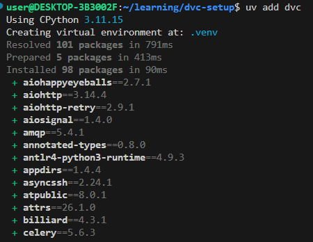
- installing the dvc library using [uv - package manager](https://github.com/Gary-XC/uv-package-manager/blob/master/README.md)

```
dvc init
```
- the initialization of DVC should only be ran in the project repo

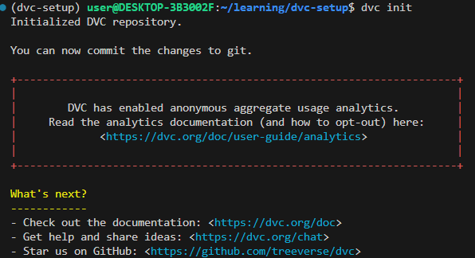
Which will then set up the following dir:

```text
project-name/
├── .dvc/
│   ├── config       
│   └── .gitignore
├── .dvcignore       # prevents DVC from tracking unnecessary files
└── .git/            # standard Git tracking folder
```

Adding & Tracking Data:
*DVC Get*
```bash
dvc get https://github.com/user_name/sample_dataset
```
- is similar to `curl` or `wget`, but is designed to solely download data that is being tracking by DVC or Git inside a Git repo
    - works by connecting to the Git repository, reading the .dvc metadata file, then downloads the entire dataset from the remote storage


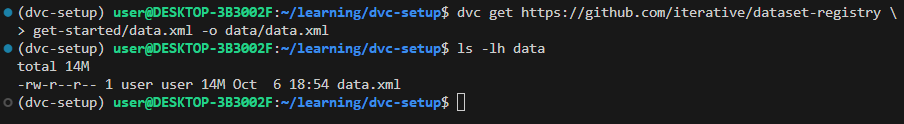
- this downloads sample data from the path `get-started/data.xml`
- and opens it in data/data.xml file on the local machine
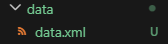


*DVC Add*
```bash
dvc add path_to_file/file_name path_to_file_2/file_name_2 ...
```
- similar to adding files to git commit, with both the path and name have to be included
- adding multiple dataset files at the same time requires separating them with a space

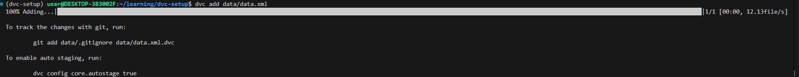
- after adding the files to DVC's tracking, there will be prompts from DVC to add files that connect DVC and Git's version control
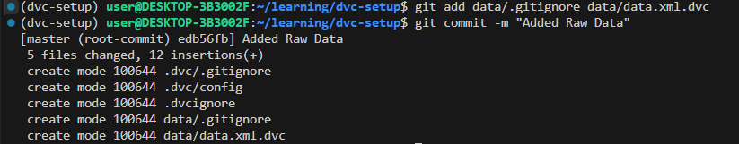
- upon executing the provided github commands, it will add everything needed for DVC and Git to version control data

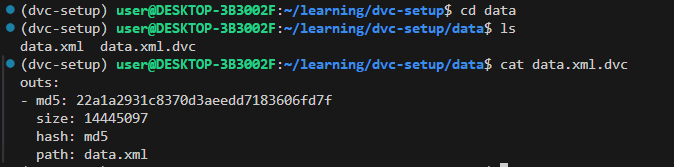
- going into the data dir, and checking out whats in the `data.xml.dvc` file using cat (nano will also work)
- from the outputs the following information can be gathered from the lightweight text file
    - md5: unique signature that was generated from the contents of the datafile
        - it is used as a key to find the actual file that is stored in the `.dvc/cache` folder
        - the value changes even with singular byte changes in the dataset
        - metafile that is linked to the data, and instead of versioning the actual data file, this is what gets versioned instead
    - size: is the total size of the tracked file in bytes
        - in this case the data file is 14.4 megabytes
    - hash: md5
        - is the cryptographic algorithm that was used to create the signature
    - path: data.xml
        - is the relative location and filename from where it was called 
        - in this case, since the current dir is `/data` the location is in the folder


#### Setting up Remote Storage
Connecting To Cloud/Remote Storage

```bash
dvc remote add -d storage /chosen_remote_storage_connection_link
```
- dvc also supports a lot of remote storage types like
    - Amazon S3
    - NFS
    - SSH
    - Google Drive
    - Azure Blob Storage
    - (Hadoop Distributed File System)

After remote storage is added/configured, then data can be pushed to the storage for version control

```bash
dvc push
```
- the push command copies the data that was cached (in a local hidden dir, after dvc add was called with the files + file path)
- then the provided git commands can be ran to use Git to track the data changes

```bash
dvc pull
```
- after DVC data is stored remotely
- they can be downloaded using dvc pull (for others or in a new project)
- this is ran after using git pull/git clone

Connecting To Google Drive
```bash
dvc remote add -d storage gdrive://google_drive_folder_id
```

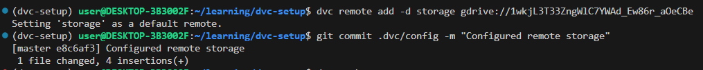
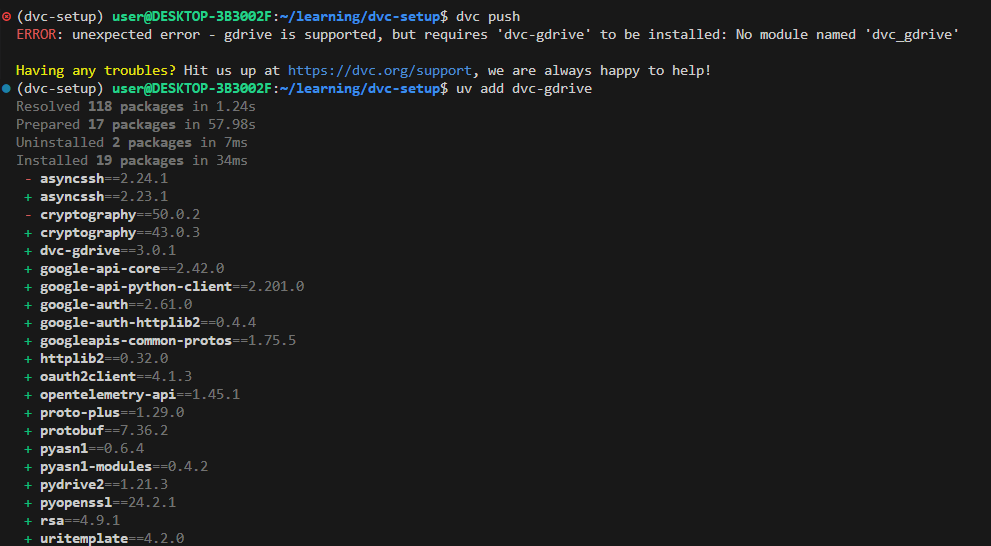
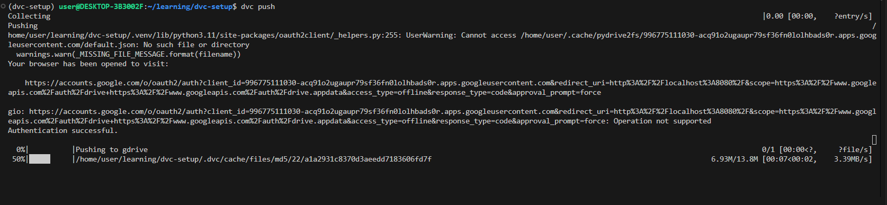
[How to set up Google Drive with DVC](google_cloud_setup.md)
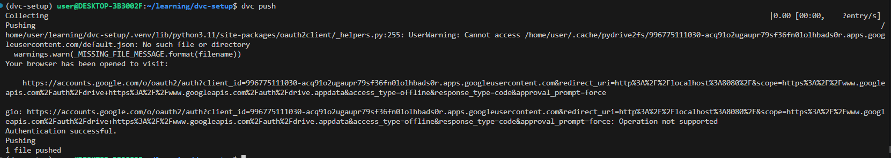
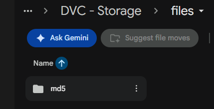

---


#### Push & Pull Data
- dvc works by only using github to track where the dataset is being stored via the data.xml.dvc 
    - where the location and exact version is being tracking in the data.xml.dvc file 
    - which is version controlled using github and git
    - and the dataset is not being tracked
- this prevent larger files like datasets from getting pushed into dvc and potentially exceeding the limit of github

To simulate pushing data, the dataset first has to be updated or more data is obtained through an external source, for this example, the dataset content is doubled

```bash
cp data/data.xml /tmp/data.xml
cat /tmp/data.xml >> data/data.xml
```
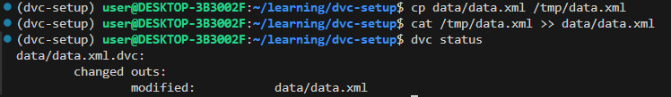
- this creates a copy of the current data into a temporary folder, the contents of which is then copied into the dataset


```bash
dvc add data/data.xml
git commit data/data.xml.dvc -m "Dataset updates"
```
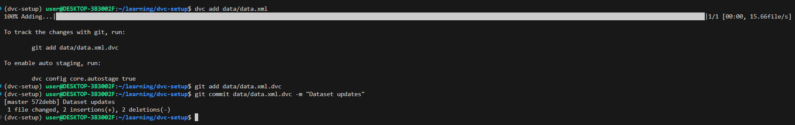


---

#### Resources
[DVC - Information](https://medium.com/@utsavraj.ptn04/decoding-data-version-control-dvc-a-beginners-guide-29e16c5f2789)
[DVC - Quick Start Guide](https://doc.dvc.org/start)
[DVC - Hands-On Tutorial](https://www.youtube.com/watch?v=kLKBcPonMYw)