## Creating Google Cloud Credentials
So that DVC is able to save datasets to google drive


Select or Create a Project:
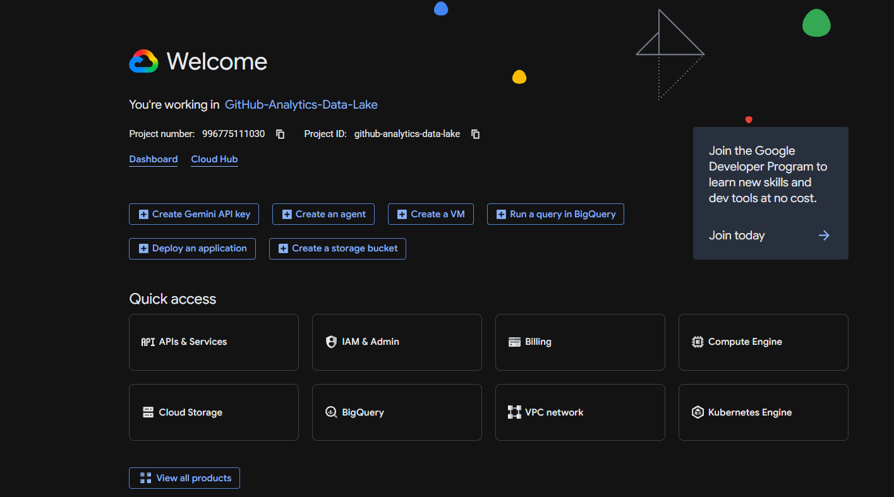
- then click on api and services
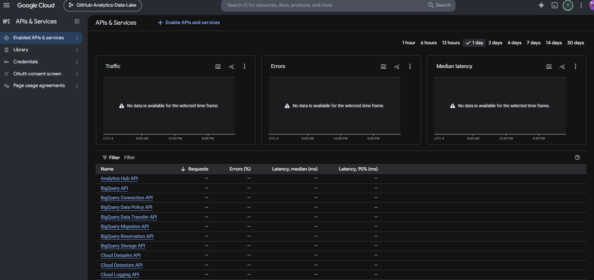
- then click on library and search for `Google Drive API`
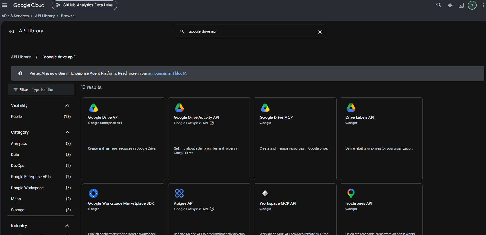
- after selecting google drive api, click enable, then click on manage
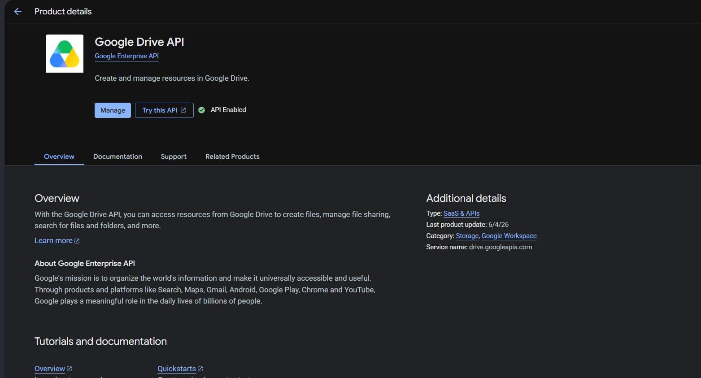
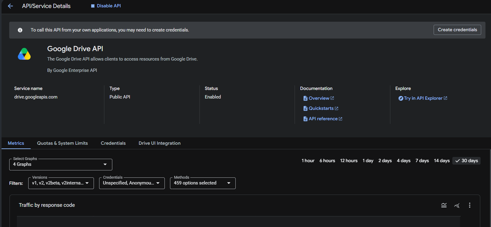
- click on create credentials
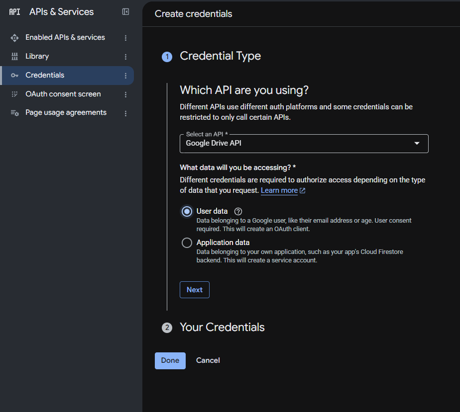
- select user and click next

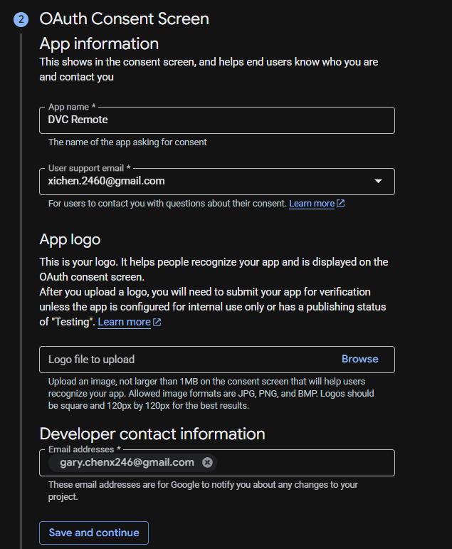
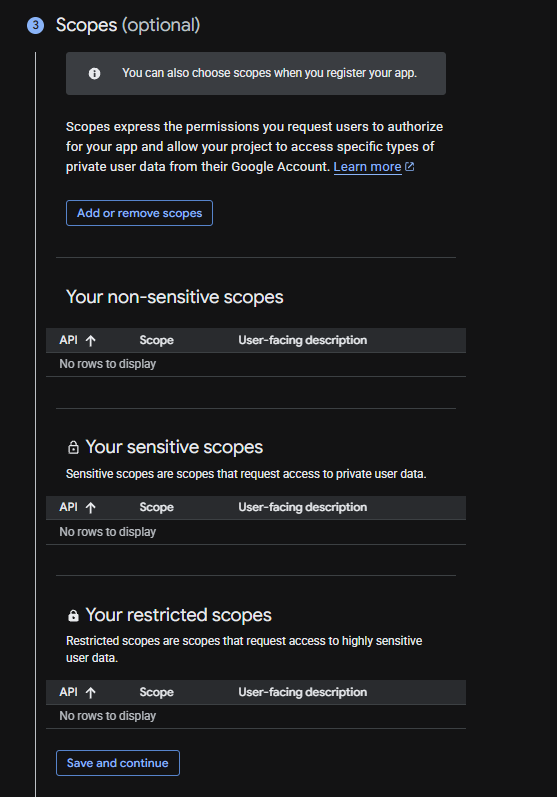

- Create the Client ID and Client Secret by selecting Desktop app for the Application type(Under OAuth Client ID)
- add the Client ID and Client Secret into the dvc-setup project directory by using:
```
dvc remote modify --local storage gdrive_client_id "YOUR_CLIENT_ID"
```

```
dvc remote modify --local storage gdrive_client_secret "YOUR_CLIENT_SECRET"
```

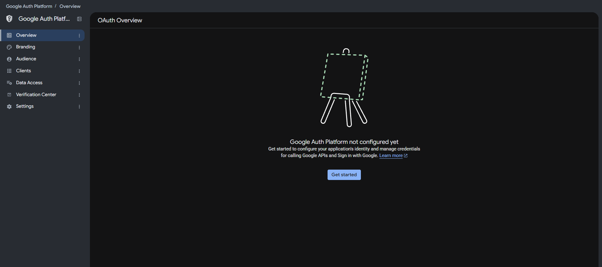
- go to Google Auth Platform and click on Audience to add your gmail account as an authorized Test users
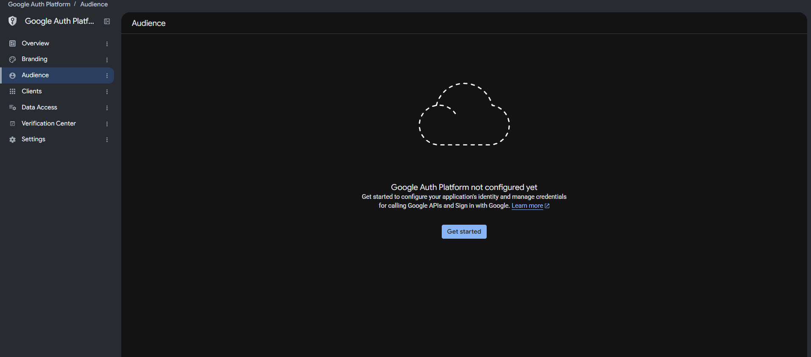
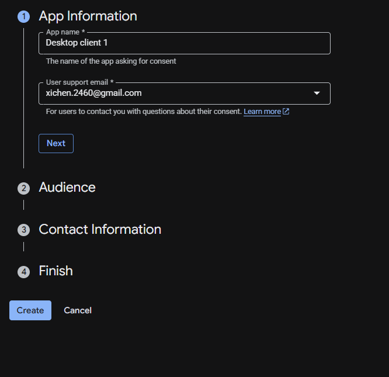
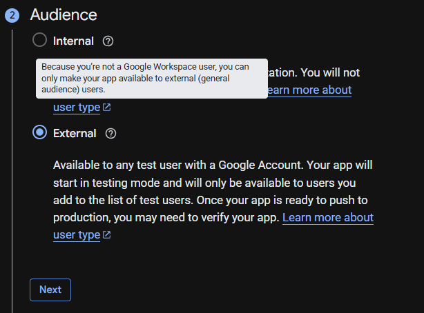
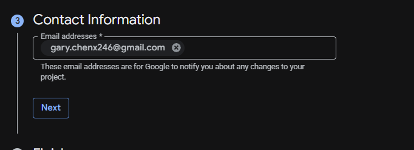
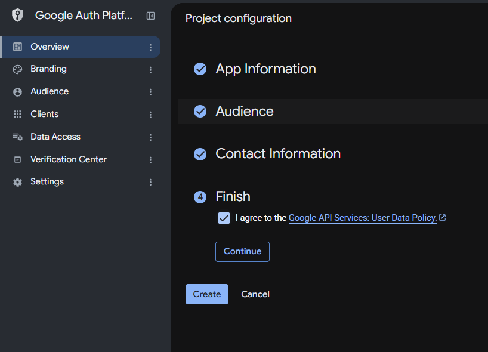
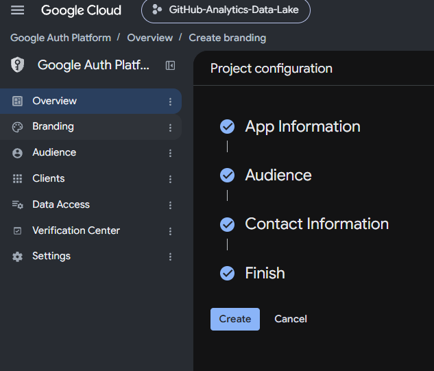
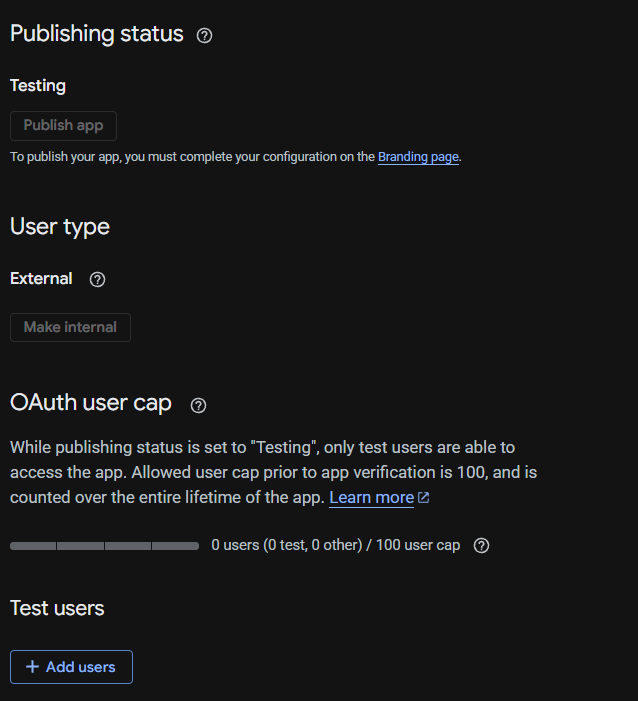
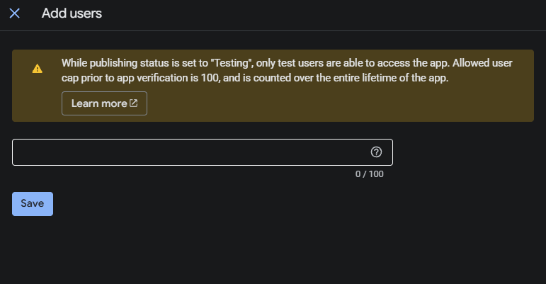